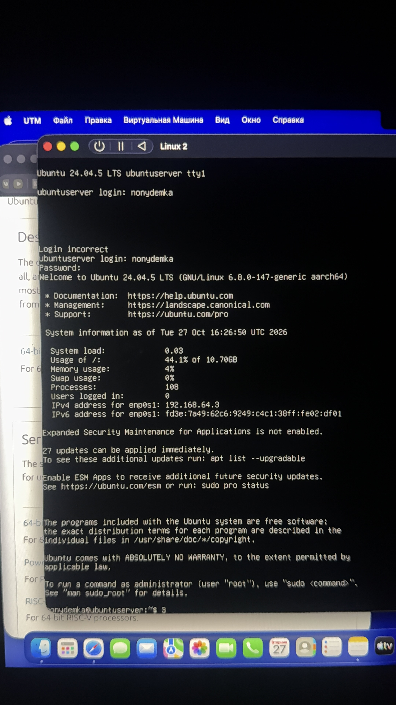

# Лабораторная работа №1: Установка первой виртуальной машины

## Описание
В рамках данной лабораторной работы была успешно развёрнута и настроена виртуальная машина Ubuntu Server (ARM64) на базе Apple Silicon с использованием гипервизора UTM.

## Параметры виртуальной машины
* **ОС**: Ubuntu Server 24.04 LTS (ARM64)
* **Гипервизор**: UTM
* **Процессор (CPU cores)**: 2
* **ОЗУ (RAM)**: 2 GB
* **Диск (Disk)**: 25 GB
* **Пользователь**: `nonudemka`

## Подтверждение успешной установки
Ниже представлен скриншот успешной загрузки системы и входа в учётную запись:

